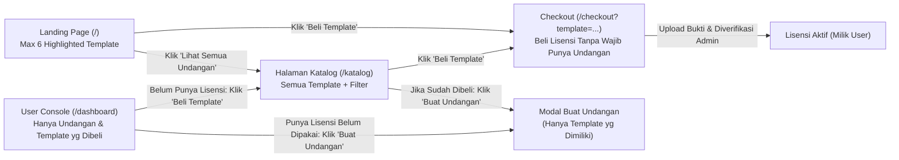

# Laporan Audit Sistem & Arsitektur UX — Undangan Online (InfoMase)

**Tanggal Audit:** 07 November 2026  
**Auditor:** Argon (AI Agentic Engineering)  
**Cakupan:** Frontend Next.js (`src/`) & Backend CodeIgniter 4 (`backend-ci4/`)

---

## 1. Executive Summary

Sistem **InfoMase Undangan Online** secara fondasi teknis (komponen editor, rendering 8 template undangan, manajemen tamu, RSVP, dan verifikasi pembayaran manual di Admin CI4) sudah berjalan dengan baik. Namun, terdapat **cacat desain alur bisnis (Business Flow Defect)** pada relasi antara **Pembelian Template (Order/Licence)** dan **Pembuatan Undangan (Invitation)**.

Saat ini sistem dibangun dengan asumsi **"Buat Draf Undangan Dulu $\rightarrow$ Baru Beli Lisensi untuk Undangan Tersebut"**, sedangkan perilaku natural pengguna (dan tombol di Landing Page) adalah **"Pilih/Beli Template Dulu (seperti Marketplace) $\rightarrow$ Baru Buat Undangan dari Template yang Dibeli"**. Ketidaksinkronan ini yang memicu bug fatal **`Undangan tidak ditemukan`** saat checkout dan kebingungan UX di Dashboard maupun Katalog.

---

## 2. Root Cause Analysis: Bug `Undangan tidak ditemukan` di Checkout

### Gejala yang Ditemukan User
Saat pengguna baru mendaftar akun lalu menekan tombol **Beli** pada katalog yang mengarah ke:
`http://localhost:3000/checkout?template=tropical-beach`

Muncul tampilan error:
> **Undangan tidak ditemukan**  
> Pilih undangan milik akun ini sebelum membeli lisensi.  
> [Kembali ke dashboard]

### Penyebab Teknis (Root Cause)
1. **Di Frontend ([`CheckoutScreen.tsx`](file:///h:/Magang/undangan-online/src/app/checkout/CheckoutScreen.tsx#L36-L99)):**
   ```tsx
   const invitationId = selectedInvitationId ?? requestedInvitation ?? invitations[0]?.id ?? '';
   const invitation = invitations.find((i) => i.id === invitationId);
   ...
   if (!invitation) return <div className="container-narrow"><h1>Undangan tidak ditemukan</h1>...</div>;
   ```
   Ketika pengguna baru saja daftar akun, array `invitations` miliknya masih kosong (`[]`). Link dari Landing Page (`/checkout?template=tropical-beach`) tidak menyertakan `?undangan=...` dan pengguna memang belum punya objek undangan. Akibatnya `invitation` bernilai `undefined` dan halaman Checkout langsung memblokir transaksi.

2. **Di Backend & Database ([`2026-11-06-000001_CreateUndanganOnlineSchema.php`](file:///h:/Magang/undangan-online/backend-ci4/app/Database/Migrations/2026-11-06-000001_CreateUndanganOnlineSchema.php#L1026-L1203) & [`OrderService.php`](file:///h:/Magang/undangan-online/backend-ci4/app/Services/OrderService.php#L33-L37)):**
   - Tabel `orders` dan `template_licences` memiliki kolom `invitation_id BIGINT UNSIGNED NOT NULL` (wajib terikat ke `invitations.id` yang sudah ada).
   - Tabel `template_licences` bahkan **tidak memiliki kolom `user_id`**, melainkan hanya `invitation_id`, `template_id`, dan `order_id`.
   - `OrderService::checkout()` mewajibkan `invitationId` dikirim di payload; jika kosong, langsung melempar exception `404 Undangan tidak ditemukan`.

3. **Bug Tambahan — Pengunjung Belum Login Melihat Data Demo Palsu di Checkout:**
   - Di [`invitationStore.tsx`](file:///h:/Magang/undangan-online/src/lib/invitationStore.tsx#L256-L269), jika pengunjung **belum login** (`hasServerSession() === false`), store mengisi `invitations` dengan `[DEMO_INVITATION]` ("Raka & Sinta").
   - Akibatnya, pengunjung yang belum login bisa melihat halaman `/checkout` seolah-olah sedang membeli untuk undangan "Raka & Sinta", tetapi saat klik tombol bayar baru ditolak. Sebaliknya, begitu mereka **login/register**, `invitations` menjadi `[]` dan mereka justru terkena error `Undangan tidak ditemukan`!

---

## 3. Audit Masalah UX & Redundansi Alur Saat Ini

### 3.1. Redundansi Katalog Template (Dua Tempat yang Berbeda)
Saat ini ada **dua halaman daftar template** yang tumpang tindih:
1. **Landing Page (`/#template` di [`LandingPage.tsx`](file:///h:/Magang/undangan-online/src/components/marketing/LandingPage.tsx#L325-L410))**: Menampilkan semua 8 template sekaligus tanpa filter/pencarian, dengan tombol langsung ke `/checkout?template=...`.
2. **Console Katalog (`/dashboard/katalog` di [`KatalogScreen.tsx`](file:///h:/Magang/undangan-online/src/app/dashboard/katalog/KatalogScreen.tsx))**: Halaman di dalam sidebar dashboard yang menampilkan 8 template yang sama persis dengan fitur search & filter.

**Masalah:**
- User bingung harus melihat katalog di depan atau di dalam console.
- Console user menjadi penuh dengan etalase jualan padahal console seharusnya fokus sebagai ruang kerja (*workspace*) mengelola undangan/template yang sudah dibeli.

### 3.2. Kesalahan UX di Dashboard ("Belum ada undangan" & Tombol Buat Undangan)
Di [`src/app/dashboard/page.tsx`](file:///h:/Magang/undangan-online/src/app/dashboard/page.tsx#L76-L80) dan [`ConsoleRail.tsx`](file:///h:/Magang/undangan-online/src/components/console/ConsoleRail.tsx#L185-L187):
- Terdapat tombol **"Undangan baru"** dan **"Buat undangan pertama"** untuk semua user baru, walaupun mereka **belum punya lisensi/belum pernah beli template**.
- Begitu diklik, muncul [`CreateInvitationModal.tsx`](file:///h:/Magang/undangan-online/src/components/console/CreateInvitationModal.tsx#L162) yang mengizinkan user memilih **semua 8 template** (termasuk yang belum dibeli), membuat draf, mengedit semuanya, dan baru dikunci saat mau klik "Tayangkan".
- Selain itu, di bagian bawah Dashboard (baris 286) masih tertulis: *"Template pertama Anda gratis — mulai dari sana."*

### 3.3. Keberadaan Template Gratis (Harus Dihapus)
Saat ini template `boho-botanical` (`undangan_1`) diset `price: 0` (Gratis), dan berbagai teks di sistem mengiklankan template gratis:
- [`src/lib/templates.ts`](file:///h:/Magang/undangan-online/src/lib/templates.ts#L61): `Boho Botanical` `price: 0`, `badge: 'Gratis untuk dicoba'`, `formatIDR(0)` menghasilkan `'Gratis'`.
- [`TemplateSeeder.php`](file:///h:/Magang/undangan-online/backend-ci4/app/Database/Seeds/TemplateSeeder.php#L67): `price => 0.00`, `badge => 'Gratis untuk dicoba'`.
- [`LandingPage.tsx`](file:///h:/Magang/undangan-online/src/components/marketing/LandingPage.tsx): Hero tick-list, kartu Pricing "Template gratis", dan FinalCta ("Mulai dari template gratis").
- [`RegisterScreen.tsx`](file:///h:/Magang/undangan-online/src/app/register/RegisterScreen.tsx#L63): Subtitle *"Gratis. Template pertama Anda tidak dikenakan biaya."*
- [`InvitationService.php`](file:///h:/Magang/undangan-online/backend-ci4/app/Services/InvitationService.php#L199-L253): Method `grantFreeLicence()` yang menerbitkan lisensi Rp 0 secara otomatis.
- [`Admin/TemplateController.php`](file:///h:/Magang/undangan-online/backend-ci4/app/Controllers/Admin/TemplateController.php#L24-L45): Filter tab "Gratis" vs "Berbayar" di Admin Console.

---

## 4. Temuan Audit Tambahan (Kode & Sinkronisasi Backend-Frontend)

Selain masalah yang Anda laporkan, hasil pemeriksaan menyeluruh menemukan beberapa celah teknis dari developer sebelumnya yang perlu dibereskan sekalian:

1. **Data Katalog Frontend Masih Hardcoded (Tidak Sinkron dengan Database SQL):**
   - Walaupun backend CI4 sudah punya tabel `templates` dan endpoint `GET /api/v1/templates` (serta fitur edit harga/nama/status template di Admin CI4 `/admin/templates`), Frontend **sama sekali tidak memanggil `templatesApi.getAll()`**!
   - Semua halaman FE membaca konstanta statis `TEMPLATES` dari [`src/lib/templates.ts`](file:///h:/Magang/undangan-online/src/lib/templates.ts). Jika Admin mengubah harga atau status highlighted di database SQL, tampilan Frontend tidak akan berubah kecuali dihubungkan ke API.

2. **Check-in Hari-H Tidak Tersimpan ke Database (`DaySection.tsx`):**
   - Di [`DaySection.tsx`](file:///h:/Magang/undangan-online/src/components/console/sections/DaySection.tsx#L17), state check-in tamu hanya disimpan di `useState<Record<string, boolean>>({})` lokal tanpa memanggil endpoint `PATCH /api/v1/invitations/{id}/guests/{guestId}/check-in` yang sebenarnya sudah ada di backend CI4. Saat halaman di-refresh, semua status check-in tamu hilang.

3. **Impor Banyak Tamu (Bulk Guest) Menembak Request Satu-Satu:**
   - Di [`GuestsSection.tsx`](file:///h:/Magang/undangan-online/src/components/console/sections/GuestsSection.tsx#L251-L254), fitur impor banyak tamu melakukan `lines.forEach(() => addGuest(...))` yang memicu puluhan HTTP POST paralel, padahal `guestsApi.bulkAdd()` (`POST /invitations/{id}/guests/bulk`) sudah tersedia.

4. **Placeholder Template WhatsApp Tidak Konsisten antara FE & BE:**
   - Di Backend [`InvitationService.php`](file:///h:/Magang/undangan-online/backend-ci4/app/Services/InvitationService.php#L405), default WA template memakai format `{{nama_tamu}}` dan `{{link_undangan}}`, sedangkan di Frontend [`GuestsSection.tsx`](file:///h:/Magang/undangan-online/src/components/console/sections/GuestsSection.tsx#L33-L40) memakai `{guestName}` dan `{link}`. Akibatnya, undangan yang baru dibuat dari backend memiliki placeholder WA yang tidak tergantikan saat dikirim dari FE.

---

## 5. Rancangan Solusi & Arsitektur UX Baru (Marketplace Mini)

Sesuai arahan Anda, kita akan merombak alur menjadi seperti **Marketplace Template Undangan** yang bersih, intuitif, dan bebas redundansi:



### Detail Perubahan yang Akan Dikerjakan:

#### A. Database & Backend (CI4)
1. **Migrasi SQL Baru (`AddHighlightAndUserBoundLicences`):**
   - **Tabel `templates`**: Tambah kolom `is_highlighted TINYINT(1) DEFAULT 0`. Set 6 template unggulan menjadi `is_highlighted = 1`.
   - **Hapus Template Gratis**: Ubah harga `boho-botanical` (`undangan_1`) dari `0` menjadi berbayar (misal `Rp 49.000`, `compare_at_price: Rp 99.000`, badge `'Populer'`). Tidak ada lagi template gratis (`price = 0`).
   - **Tabel `orders` & `template_licences`**:
     - Ubah `orders.invitation_id` menjadi **`NULLABLE`** (agar user bisa checkout & beli template terlebih dahulu sebelum membuat undangan).
     - Tambah kolom `user_id BIGINT UNSIGNED` di `template_licences` dan ubah `template_licences.invitation_id` menjadi **`NULLABLE`**.
     - Dengan ini, lisensi yang baru dibeli berstatus **"Tersedia / Siap Dipakai"** (`invitation_id = NULL`). Saat user klik **"Buat Undangan"** dari template tersebut, `invitation_id` pada lisensi dan order otomatis terisi dengan ID undangan yang baru dibuat!
2. **Update API & Admin CI4:**
   - `GET /api/v1/templates` mendukung filter `?highlighted=1` dan mengembalikan field `isHighlighted`.
   - Admin `/admin/templates` dilengkapi toggle/checkbox **"Tampilkan di Highlight Landing Page (Maks 6)"** dan menghapus tab "Gratis".
   - `POST /api/v1/orders/checkout` tidak lagi menolak user yang belum punya undangan (`invitationId` opsional). Jika user belum login saat membuka `/checkout`, diarahkan ke `/login?redirect=/checkout?template=...`.
   - `POST /api/v1/invitations` (Buat Undangan) memvalidasi bahwa user memiliki lisensi aktif untuk `templateId` yang dipilih dan mengikat lisensi tersebut ke undangan baru.

#### B. Frontend Public & Katalog (Page ABC = `/katalog`)
1. **Landing Page (`/`):**
   - Section Katalog hanya menampilkan **maksimal 6 template** yang berstatus `is_highlighted = true` (sinkron dengan API backend).
   - Dilengkapi tombol jelas **"Lihat semua undangan"** yang mengarah ke halaman katalog khusus **`/katalog`**.
   - Menghapus semua klaim "Template gratis / Rp 0" di Hero, Pricing, FAQ, Register, dan CTA.
2. **Halaman Katalog Khusus (`/katalog` — Page ABC):**
   - Menjadi **satu-satunya pusat katalog lengkap** dengan pencarian dan filter kategori.
   - **Smart Action Button per Kartu Template:**
     - Jika user **sudah membeli lisensi** template tersebut dan belum dipakai buat undangan $\rightarrow$ tampil badge **"Sudah Dibeli"** dan tombol utama berubah menjadi **"Buat Undangan"** (langsung membuka pembuatan undangan dengan template tersebut).
     - Jika user **sudah membuat undangan** dengan template tersebut $\rightarrow$ tampil tombol **"Kelola Undangan"** (+ opsi beli lagi jika ingin buat acara kedua).
     - Jika **belum dibeli** $\rightarrow$ tampil tombol **"Beli Template"** yang mengarah ke `/checkout?template=<id>` + tombol **"Buka Demo"**.

#### C. Frontend Checkout (`/checkout`)
1. **Bebas Bug `Undangan tidak ditemukan`:**
   - Jika belum login $\rightarrow$ tampilkan prompt ramah untuk Masuk / Daftar dengan otomatis kembali ke halaman checkout template tersebut (`redirect`).
   - Jika sudah login $\rightarrow$ langsung tampilkan ringkasan template & pilihan metode pembayaran (QRIS / Transfer Bank / E-Wallet) **tanpa mewajibkan punya undangan terlebih dahulu**.
   - Setelah bayar & upload bukti transfer (atau setelah diverifikasi admin), user bisa langsung menekan **"Buat Undangan Sekarang"** dari halaman pesanan/katalog/dashboard.

#### D. Frontend User Console (`/dashboard`)
1. **Hapus Redundansi Katalog di Dalam Console:**
   - Hapus menu "Katalog template" dari sidebar internal console (`/dashboard/katalog` di-redirect ke `/katalog`), sehingga console murni berisi **Undangan Saya** dan **Pesanan & Lisensi**.
2. **Dashboard Ringkasan (`/dashboard`) Sesuai Kepemilikan Lisensi:**
   - **Jika belum punya undangan & belum punya lisensi:** Tampil "Belum ada undangan" dengan tombol utama **"Beli Template"** yang mengarah ke `/katalog` (bukan tombol Buat Undangan).
   - **Jika punya lisensi template yang sudah dibeli tapi belum dibuat undangannya:** Tampil banner/kartu **"Template Siap Digunakan"** dengan tombol **"Buat Undangan"** langsung dari lisensi tersebut.
   - **Jika sudah punya undangan:** Hanya menampilkan undangan & template yang sudah dibeli/dimiliki. Modal "Buat Undangan" hanya mengizinkan memilih dari lisensi template yang sudah dimiliki (atau mengarahkan ke `/katalog` jika ingin beli template baru).
   - Di halaman editor undangan (`DesignSection.tsx`), tidak lagi menampilkan katalog semua template yang belum dibeli, melainkan fokus pada informasi lisensi aktif undangan tersebut (dan link ke `/katalog` bila ingin membeli template lain).

---

## 6. Rencana Eksekusi (Action Plan)

Jika Anda setuju dengan hasil audit dan rancangan di atas, tahapan pengerjaan berikutnya adalah:
1. **Step 1 (Database & Backend CI4):** Buat migration SQL (`is_highlighted`, hapus harga gratis, `invitation_id` nullable pada `orders` & `template_licences`, tambah `user_id` di `template_licences`), update Seeder, `OrderService`, `InvitationService`, `TemplateController`, dan Admin view.
2. **Step 2 (Halaman Katalog `/katalog` & Landing Page `/`):** Buat page `/katalog` (Page ABC), batasi Landing Page maksimal 6 highlighted template + tombol "Lihat semua undangan", dan bersihkan seluruh teks "Gratis".
3. **Step 3 (Perbaikan Alur `/checkout`):** Perbaiki `CheckoutScreen.tsx` & `invitationStore.tsx` agar pembelian template berjalan mulus tanpa error `Undangan tidak ditemukan`.
4. **Step 4 (Perombakan User Console `/dashboard`):** Sesuaikan tombol "Buat Undangan" vs "Beli Template" berdasarkan kepemilikan lisensi, rapikan sidebar console, serta perbaiki bug minor (WA placeholder & Check-in persistence).
5. **Step 5 (Testing End-to-End):** Verifikasi alur Register $\rightarrow$ Beli Template di Checkout $\rightarrow$ Upload Bukti $\rightarrow$ Admin Verify $\rightarrow$ Buat Undangan di Dashboard/Katalog.
