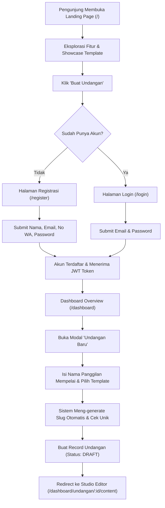
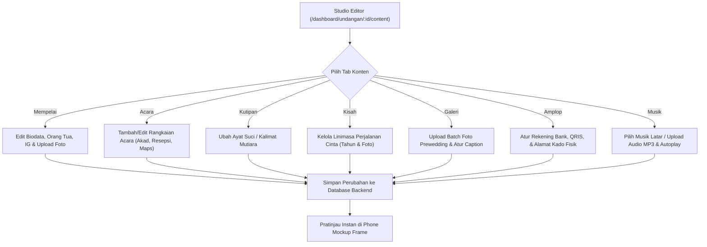
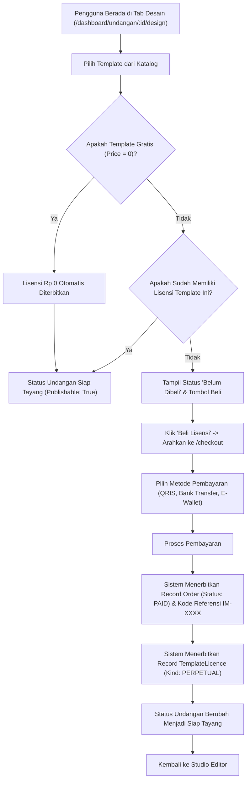
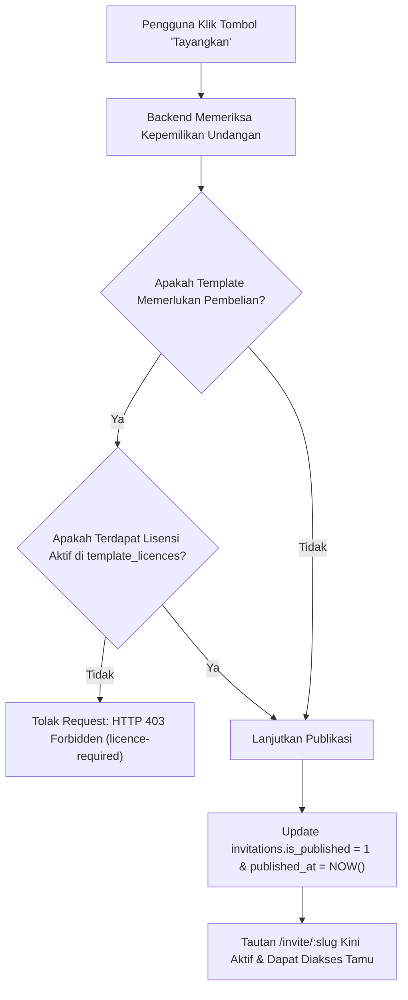
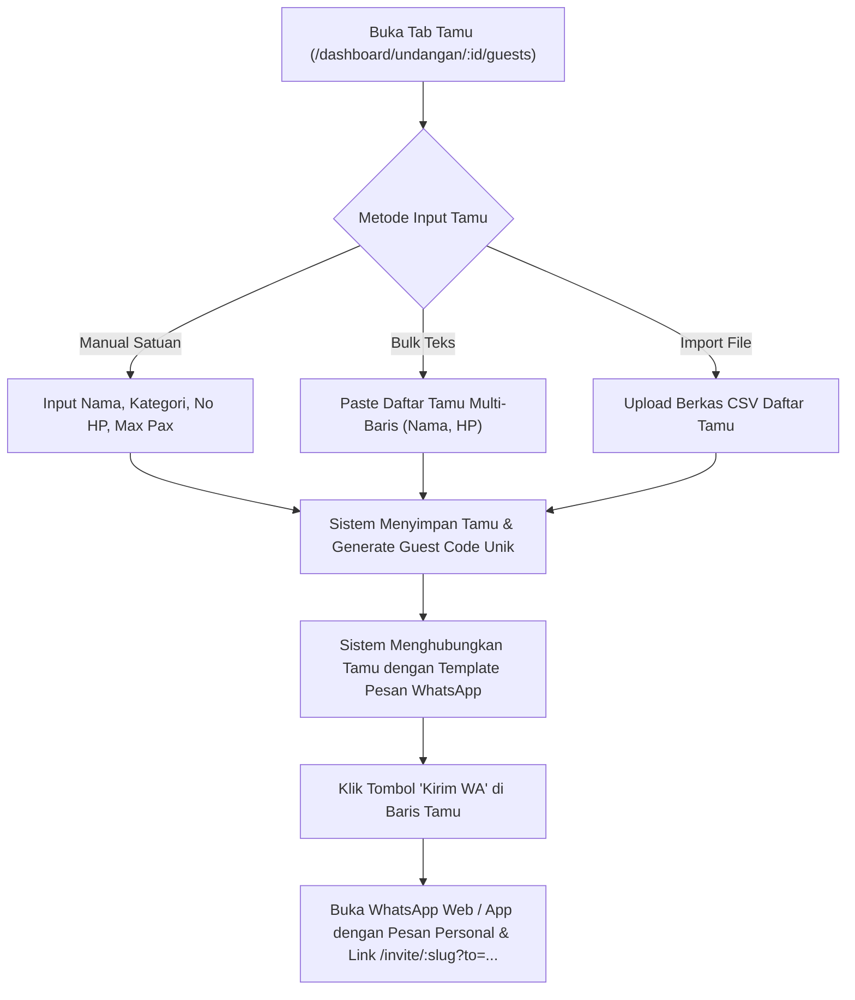
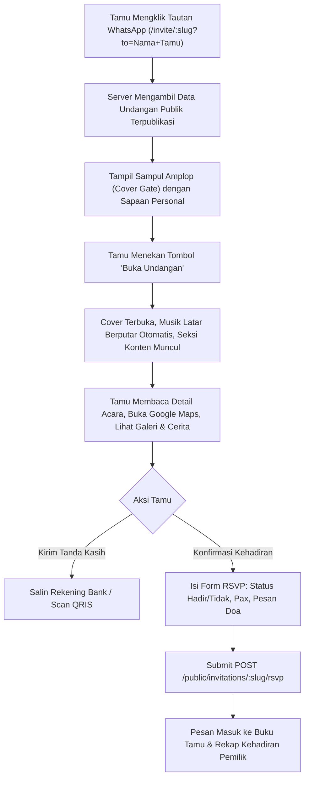
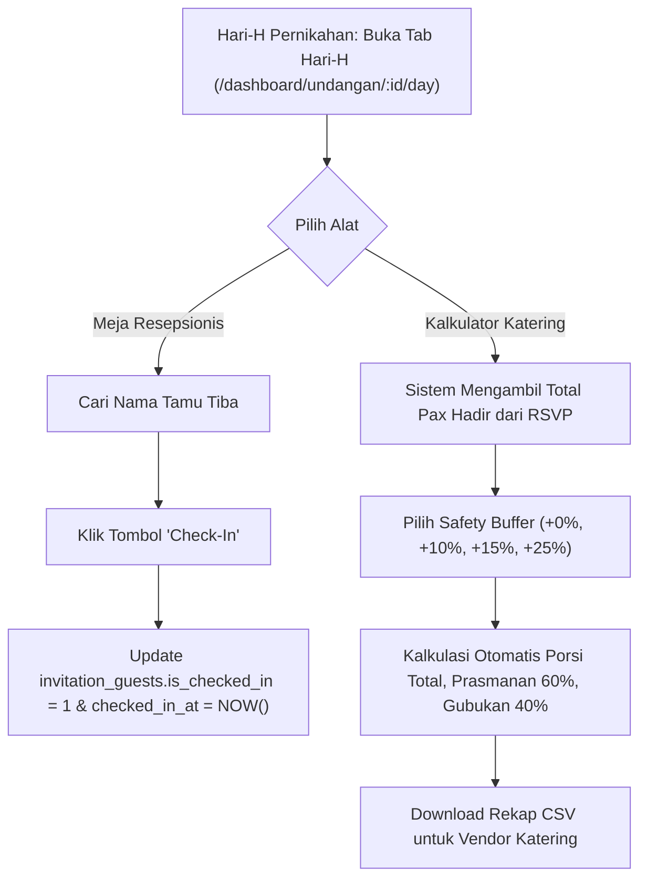
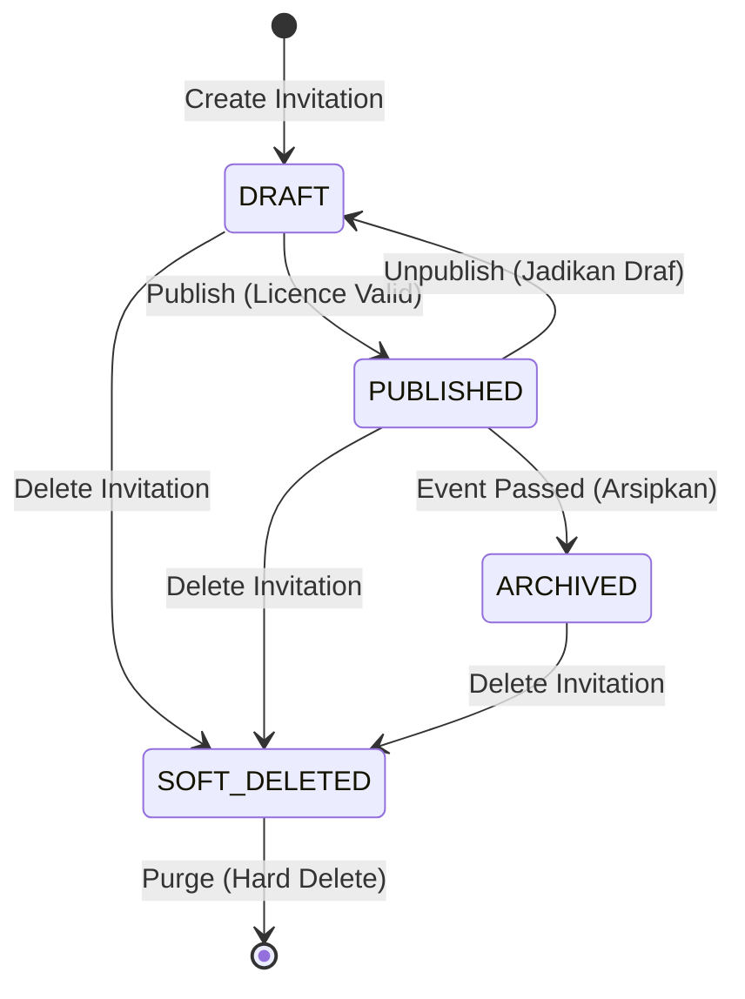
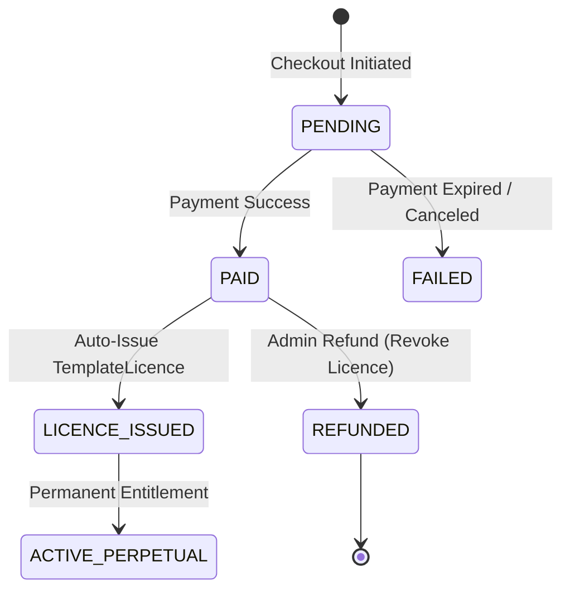

# Business Flow & System Architecture — Undangan Online (InfoMase)

Dokumen ini memetakan seluruh alur bisnis (*business flow*), perjalanan pengguna (*user journeys*), siklus hidup entitas (*entity lifecycles*), aturan validasi bisnis (*business rules*), serta aliran data (*data flow*) antar-lapisan pada sistem Undangan Online.

---

## 1. End-to-End User Journeys

### 1.1 Journey 1: Onboarding & Pembuatan Undangan Pertama



#### Langkah Detail & Transisi Data:
1. **Pendaftaran**: Pengguna mengirimkan payload registrasi. Backend memvalidasi keunikan email, meng-hash kata sandi, dan membuat entitas `users`.
2. **Inisiasi Undangan**: Pengguna mengisi nama kedua mempelai (misal: "Raka" dan "Sinta"). Sistem men-generate basis slug `raka-sinta`. Jika terjadi benturan nama yang sama, sistem menambahkan penomoran otomatis (`raka-sinta-2`).
3. **Penyimpanan Draft Awal**: Entitas `invitations` dibuat dengan status `is_published = 0`, terikat langsung ke `user_id` pemilik akun. Record default profil mempelai di `invitation_couples` dan satu acara default di `invitation_events` otomatis dibuat dalam satu transaksi database.

---

### 1.2 Journey 2: Pengisian & Kustomisasi Konten Undangan



#### Aturan Bisnis Kustomisasi:
- **Isolasi Child Resource**: Setiap perubahan pada sub-entitas (acara, galeri, rekening) **wajib menyertakan parameter `invitationId`** dan diverifikasi bahwa `invitation.user_id === authUser.id`.
- **Integritas Waktu Acara**: Tanggal acara pertama yang tercatat otomatis menyinkronkan kolom `countdown_date` pada tabel `invitations`.
- **Upload File Aman**: Media yang diunggah divalidasi tipe MIME dan ukurannya di server, lalu path berkas fisik disimpan ke kolom database terkait.

---

### 1.3 Journey 3: Pemilihan Desain, Checkout & Lisensi Permanen



#### Aturan Bisnis Lisensi:
- **Perpetual Model**: Satu lisensi berlaku selamanya untuk kombinasi `(invitation_id, template_id)`. Lisensi tidak memiliki tanggal kedaluwarsa (`expires_at = NULL`).
- **Ganti Template**: Pengguna bebas berganti template kapan saja tanpa merusak konten yang sudah diketik. Jika berpindah ke tema berbayar yang belum dibeli, undangan tidak bisa ditayangkan sampai lisensi tema tersebut dibeli. Jika berpindah kembali ke tema yang sudah pernah dibeli sebelumnya, lisensi lamanya tetap aktif.

---

### 1.4 Journey 4: Publikasi Undangan (Publish Guard)



---

### 1.5 Journey 5: Manajemen Tamu & Distribusi WhatsApp



---

### 1.6 Journey 6: Alur Tamu Membuka Undangan & RSVP Publik



---

### 1.7 Journey 7: Operasional Hari-H (Resepsionis & Katering)



---

## 2. Entity Lifecycle & State Machines

### 2.1 Invitation Lifecycle State Machine



| State | Keterangan | Akses Publik (`/invite/:slug`) | Akses Studio Pemilik |
|---|---|---|---|
| `DRAFT` | Undangan sedang dirancang, konten bebas diubah. | Tidak aktif (404/Private Notice). | Akses Penuh (Read & Write). |
| `PUBLISHED` | Undangan tayang secara resmi. | Aktif dapat dibuka seluruh tamu. | Akses Penuh (Read & Write). |
| `ARCHIVED` | Acara telah selesai, disimpan sebagai arsip kenangan. | Read-Only (opsional sesuai setting). | Read-Only. |
| `SOFT_DELETED` | Dihapus oleh pemilik (`deleted_at IS NOT NULL`). | Tidak aktif (404 Not Found). | Tidak tampil di daftar konsol. |

---

### 2.2 Order & Licence State Machine



- Ketika `Order` mencapai status `PAID`, trigger transaksi database secara atomik membuat row di `template_licences`.
- Kolom `kind` pada `template_licences` diset ke `perpetual`, menjamin undangan tersebut memiliki hak pakai desain tersebut selamanya.

---

## 3. Data Dependencies & Cascading Relationships

Untuk menjamin integritas referensial dan mencegah data yatim (*orphaned records*), dependensi antarentitas dirancang sebagai berikut:

```mermaid
flowchart TD
    User["User (Akun Induk)"]
    Order["Order (Transaksi Pembelian)"]
    Invitation["Invitation (Induk Acara)"]
    Licence["TemplateLicence (Hak Desain)"]
    
    Couple["Couple Profile"]
    Events["Events (Akad, Resepsi)"]
    Stories["Love Stories"]
    Gallery["Gallery Photos"]
    Music["Background Music"]
    Bank["Bank Accounts"]
    Gift["Physical Gift Address"]
    Guests["Guests (Buku Tamu)"]
    RSVP["RSVP Entries"]
    WATpl["WhatsApp Templates"]
    
    User -->|1:N (CASCADE)| Invitation
    User -->|1:N (RESTRICT)| Order
    Invitation -->|1:1 (CASCADE)| Couple
    Invitation -->|1:1 (CASCADE)| Music
    Invitation -->|1:1 (CASCADE)| Gift
    Invitation -->|1:N (CASCADE)| Events
    Invitation -->|1:N (CASCADE)| Stories
    Invitation -->|1:N (CASCADE)| Gallery
    Invitation -->|1:N (CASCADE)| Bank
    Invitation -->|1:N (CASCADE)| Guests
    Invitation -->|1:N (CASCADE)| RSVP
    Invitation -->|1:N (CASCADE)| WATpl
    Order -->|1:1 (RESTRICT)| Licence
    Invitation -->|1:N (CASCADE)| Licence
```

### Aturan Penghapusan (*Delete Behavior*):
1. **Penghapusan Undangan (`DELETE invitations`)**:
   - Seluruh data pendukung yang melekat langsung pada undangan (`invitation_couples`, `invitation_events`, `invitation_stories`, `invitation_galleries`, `invitation_musics`, `invitation_bank_accounts`, `invitation_gifts`, `invitation_guests`, `invitation_rsvps`, `invitation_wa_templates`) **dihapus secara otomatis via `ON DELETE CASCADE`**.
   - Berkas fisik media (foto dan MP3) di direktori storage server dibersihkan oleh service handler.
2. **Integritas Pesanan Keuangan (`orders`)**:
   - Penghapusan undangan **DILARANG** menghapus riwayat transaksi keuangan pada tabel `orders` (`ON DELETE RESTRICT` atau `SET NULL` pada `invitation_id`) untuk keperluan pembukuan keuangan dan audit.

---

## 4. Matriks Operasi CRUD per Entitas

| Entitas | Create (C) | Read (R) | Update (U) | Delete (D) | Soft Delete |
|---|---|---|---|---|---|
| `users` | Registrasi akun | Ambil profil (`/auth/me`) | Edit nama/avatar/HP | Hapus akun sendiri | Ya |
| `invitations` | Modal Undangan Baru | List dashboard & Studio | Ganti judul/slug/tema | Hapus undangan | Ya |
| `invitation_couples` | Auto-create saat buat undangan | Studio Content & Public | Edit info mempelai | Cascade parent | Tidak |
| `invitation_events` | Tambah acara di studio | Studio Content & Public | Edit waktu & tempat | Hapus satuan/cascade | Tidak |
| `invitation_stories` | Tambah bab perjalanan | Studio Content & Public | Edit narasi & foto | Hapus satuan/cascade | Tidak |
| `invitation_galleries` | Upload foto galeri | Studio Content & Public | Edit urutan & caption | Hapus satuan/cascade | Tidak |
| `invitation_bank_accounts` | Tambah nomor rekening | Studio Content & Public | Edit nomor/nama bank | Hapus satuan/cascade | Tidak |
| `invitation_guests` | Single / Bulk / CSV import | Studio Tamu & Check-in | Edit data tamu & HP | Hapus satuan/cascade | Tidak |
| `invitation_rsvps` | Submit tamu publik | Studio RSVP & Ekspor CSV | Update status kehadiran | Hapus ucapan spam | Tidak |
| `invitation_wa_templates` | Seed default template | Studio Tamu (Tab WA) | Edit body template | Reset ke default | Tidak |
| `orders` | Checkout template | Halaman riwayat pesanan | Update status pembayaran | Larang hapus (audit) | Tidak |
| `template_licences` | Diterbitkan otomatis | Cek status tayang | Read-only | Cabut jika refund | Tidak |
| `templates` | Seeder master sistem | Katalog & Desain | Kelola admin | Disable status | Ya |

