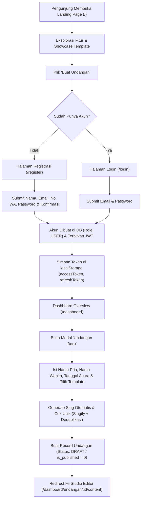
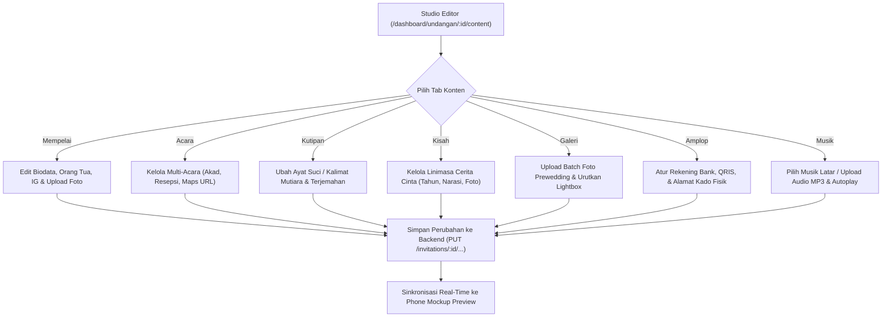
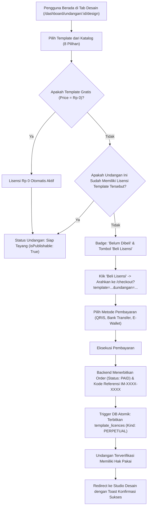
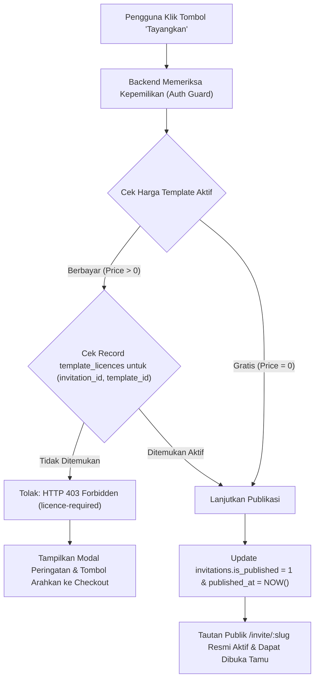
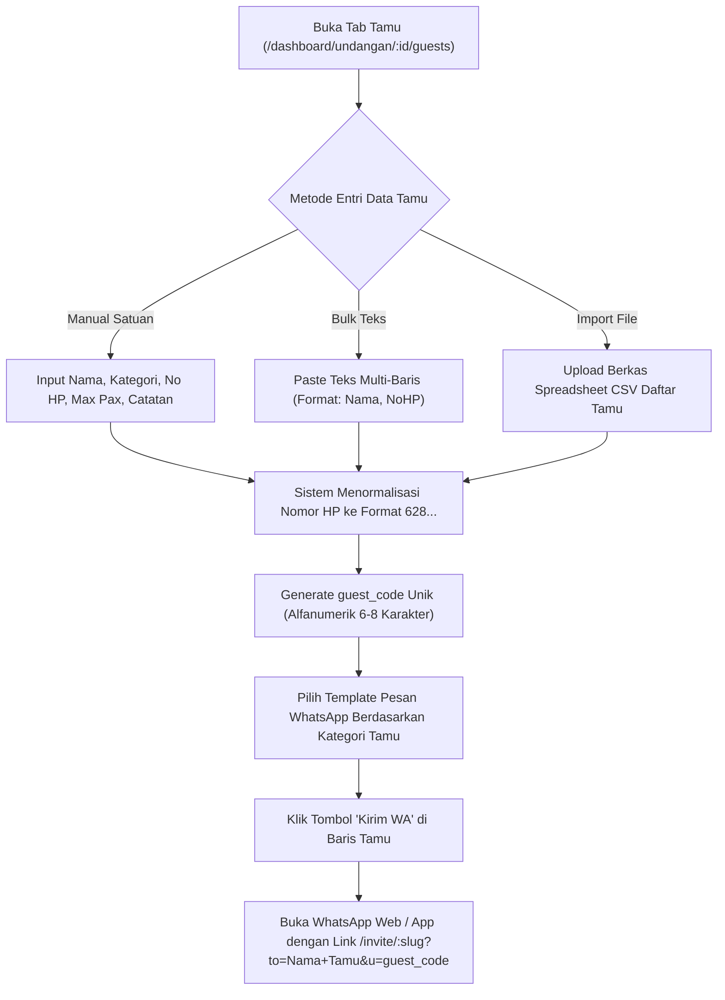
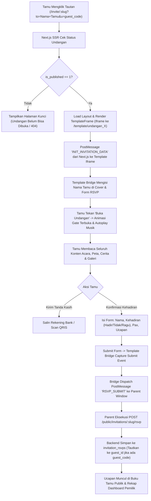
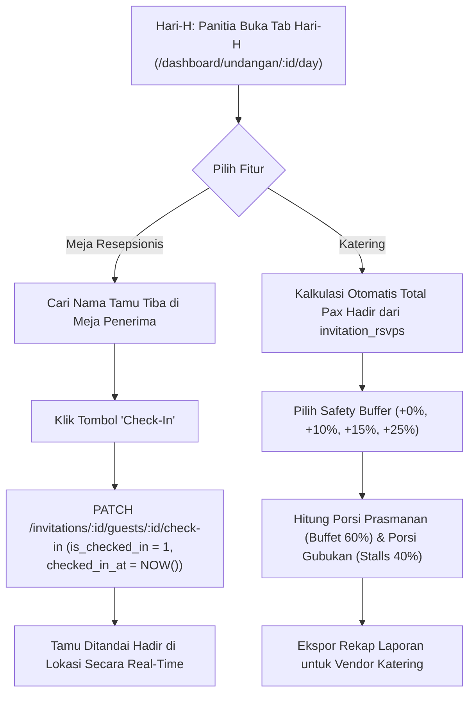
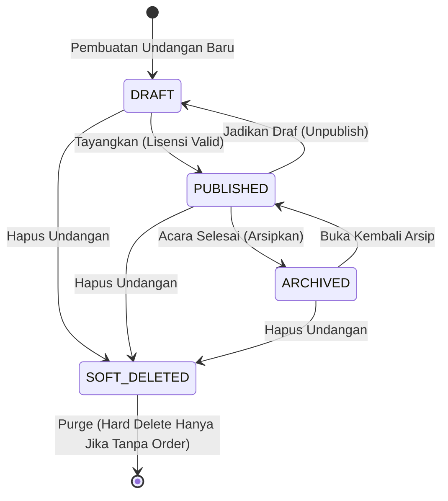
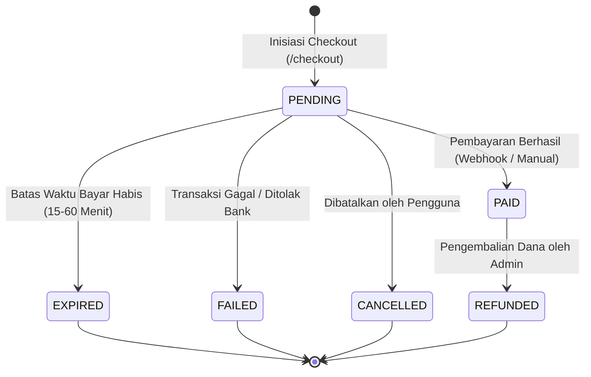
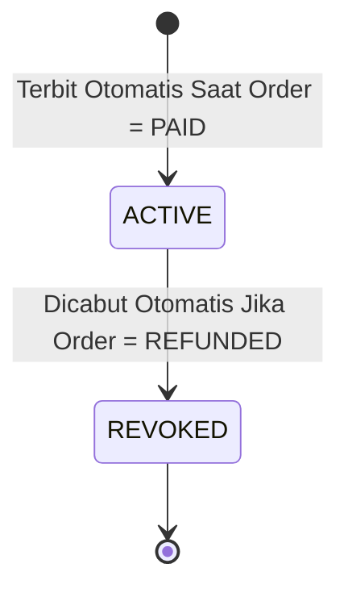

# Business Flow & System Architecture — Undangan Online (InfoMase)

Dokumen ini memetakan seluruh alur bisnis (*business flow*), perjalanan pengguna (*user journeys*), siklus hidup entitas (*entity lifecycles*), aturan validasi bisnis (*business rules*), model monetisasi & lisensi permanen (*perpetual licensing*), serta aliran data (*data flow*) antar-lapisan pada sistem Undangan Online hasil audit teknis komparatif terhadap frontend aktual (`src/`), database schema (`docs/DATABASE_DESIGN.md`), dan API spec (`docs/API_SPECIFICATION.md`).

---

## 1. End-to-End User Journeys

### 1.1 Journey 1: Onboarding, Autentikasi & Manajemen Sesi



#### Langkah Detail & Transisi Data:
1. **Pendaftaran (`POST /auth/register`)**:
   - Pengguna mengisi `name`, `email`, `phoneNumber`, `password`, dan `confirmPassword` (`src/app/register/page.tsx`).
   - Backend memvalidasi format email, keunikan email di tabel `users`, kekuatan password (min 8 karakter), kecocokan konfirmasi password, serta normalisasi nomor telepon ke format E.164 Indonesia (`628...`).
   - Backend melakukan hashing kata sandi (`PASSWORD_BCRYPT` / `ARGON2ID`) dan menyimpan record di `users`.
   - Mengembalikan response token berpasangan (`accessToken` masa aktif 24 jam dan `refreshToken` masa aktif 30 hari).
2. **Login (`POST /auth/login`)**:
   - Verifikasi email dan hash password.
   - Update kolom `last_login_at` pada tabel `users`.
   - Mencatat sesi di tabel `user_tokens` untuk mendukung rotasi token.
3. **Manajemen Sesi & Silent Refresh (`POST /auth/refresh-token`)**:
   - Frontend menyimpan token di `localStorage` (`infomase_token`, `infomase_refresh_token`, `infomase_user`) via `src/lib/api.ts` dan `src/lib/authContext.tsx`.
   - Interceptor HTTP mendeteksi token kedaluwarsa (401 Unauthorized) dan secara transparan meminta `accessToken` baru menggunakan `refreshToken`.
   - Logout (`POST /auth/logout`) mencabut token dari tabel `user_tokens` dan membersihkan `localStorage`.
   - *Demo Fallback*: Jika server backend tidak dapat dijangkau, sistem menyediakan fallback akun demo lokal (`usr-demo`) untuk pratinjau antarmuka tanpa memblokir evaluasi pengguna.

---

### 1.2 Journey 2: Pengisian & Kustomisasi Konten Undangan (Studio Content)



#### Aturan Bisnis Kustomisasi:
- **Child Resource Isolation**: Setiap mutasi sub-entitas (acara, galeri, rekening) **wajib menyertakan parameter `invitationId`** dan diverifikasi bahwa `invitation.user_id === authUser.id`. Pengguna dilarang memanipulasi sub-entitas milik undangan lain (*Anti-IDOR*).
- **Integritas Waktu Acara & Countdown**: Tanggal acara pertama yang tercatat pada `invitation_events` otomatis menyinkronkan kolom `countdown_date` pada tabel `invitations` (`src/lib/invitationStore.tsx` line 405-407).
- **Upload File & Asset Management**: Media diunggah melalui endpoint terpisah (`/upload/photo`, `/upload/gallery-batch`, `/upload/audio`). Backend memvalidasi MIME-type (`image/jpeg`, `image/png`, `image/webp`, `audio/mpeg`), membatasi ukuran (foto maks 5MB, audio maks 10MB), dan menyimpan URL berkas fisik.

---

### 1.3 Journey 3: Pemilihan Desain, Checkout & Lisensi Permanen (Monetization Flow)



#### Aturan Bisnis Lisensi:
- **Entitlement Binding**: Satu lisensi berlaku selamanya untuk kombinasi unik `(invitation_id, template_id)`. Lisensi tidak memiliki tanggal kedaluwarsa (`expires_at = NULL`).
- **Isolasi Antar-Undangan**: Lisensi melekat pada undangan, bukan akun pengguna secara global. Pembelian template untuk Undangan A tidak membuka template tersebut untuk Undangan B.
- **Katalog Harga Resmi (`src/lib/templates.ts`)**:
  - `boho-botanical` : Rp 0 (Free selamanya)
  - `modern-minimalist` : Rp 49.000
  - `tropical-beach` : Rp 49.000
  - `luxury-islamic` : Rp 79.000
  - `misty-mountain` : Rp 49.000
  - `royal-maroon` : Rp 79.000
  - `pawiwahan-agung` : Rp 89.000
  - `pawiwahan-pethak` : Rp 89.000
- **Dua Arah Penggantian Desain (Template Switching Rules)**:
  1. *Free &rarr; Free*: Selalu diizinkan, langsung siap tayang.
  2. *Free &rarr; Paid*: Konten tetap utuh. Status undangan menjadi `needsPurchase = true`. Jika sebelumnya berstatus tayang, undangan tidak boleh dibuka publik sampai lisensi dibeli.
  3. *Paid &rarr; Free*: Selalu diizinkan. Lisensi tema berbayar sebelumnya **tidak hangus** dan tersimpan permanen di dompet lisensi undangan.
  4. *Paid &rarr; Paid Baru*: Memerlukan pembelian lisensi untuk tema berbayar yang baru.
  5. *Paid Baru &rarr; Paid Lama*: Jika pengguna kembali ke tema berbayar yang sudah pernah dibeli untuk undangan tersebut, sistem langsung mengaktifkannya kembali tanpa biaya tambahan (`hasLicence = true`).

---

### 1.4 Journey 4: Publikasi Undangan (Publish Guard)



---

### 1.5 Journey 5: Manajemen Tamu & Distribusi WhatsApp



#### Aturan Kategori & Templating WhatsApp:
- Kategori tamu yang didukung: `Keluarga`, `Sahabat`, `Teman Kantor`, `VIP`, `Umum`.
- Template pesan WhatsApp (`src/lib/defaultData.ts`) secara dinamis memetakan bahasa:
  - *Formal*: Ditugaskan untuk `Keluarga`, `VIP`, `Umum`.
  - *Santai*: Ditugaskan untuk `Sahabat`, `Teman Kantor`.
  - *Singkat*: Format ringkas alternatif.
- Variabel template yang didukung: `{guestName}`, `{eventDate}`, `{eventTime}`, `{venueName}`, `{venueAddress}`, `{groomName}`, `{brideName}`, `{link}`.

---

### 1.6 Journey 6: Alur Tamu Membuka Undangan, RSVP & Sinkronisasi Buku Tamu



#### Aturan RSVP & Deduplikasi Data:
1. **Dua Mode Akses Tamu**:
   - *Personalized Link* (`?to=Nama+Tamu&u=guest_code`): RSVP otomatis ditautkan ke record `invitation_guests` (`guest_id`). Jika tamu mengirim konfirmasi ulang, sistem memperbarui (*UPSERT*) status kehadiran dan pax sebelumnya untuk menjaga akurasi kalkulator katering.
   - *Public Link* (`/invite/:slug` tanpa parameter): Diizinkan untuk memfasilitasi undangan yang disebar melalui grup publik. Record RSVP disimpan dengan `guest_id = NULL`.
2. **Proteksi Anti-Spam & Rate Limiting**:
   - Endpoint `POST /public/invitations/:slug/rsvp` dibatasi maksimal 5 submit per IP per 10 menit.
   - Input pesan disanitasi dari tag HTML berbahaya untuk mencegah serangan *Cross-Site Scripting* (XSS).
3. **Pemuatan Linimasa Ucapan (Wish List)**:
   - Endpoint `GET /public/invitations/:slug/wishes` menyajikan linimasa ucapan terpaginasi (*read-heavy* dengan caching HTTP).
   - Data ucapan disinkronisasikan oleh `template-bridge.js` ke container buku tamu pada template iframe.

---

### 1.7 Journey 7: Operasional Hari-H (Meja Resepsionis & Kalkulator Katering)



---

## 2. Entity Lifecycle & State Machines

### 2.1 Invitation Lifecycle State Machine



| State | Kondisi Database | Akses Publik (`/invite/:slug`) | Akses Studio Pemilik |
|---|---|---|---|
| `DRAFT` | `is_published = 0`, `deleted_at IS NULL` | Tidak aktif (Tampil layar terkunci / 404). | Akses Penuh (Read & Write). |
| `PUBLISHED` | `is_published = 1`, `deleted_at IS NULL` | Aktif dapat dibuka seluruh tamu. | Akses Penuh (Read & Write). |
| `ARCHIVED` | `countdown_date < NOW()` atau flag arsip aktif | Read-Only (Opsional sesuai konfigurasi). | Read-Only. |
| `SOFT_DELETED` | `deleted_at IS NOT NULL` | Tidak aktif (404 Not Found). | Disembunyikan dari daftar konsol. |

---

### 2.2 Order & Licence State Machine

Alur transaksi pesanan komersial (`orders`) dan hak guna desain (`template_licences`) dipisahkan secara tegas untuk menjamin integritas pembukuan keuangan:





#### Aturan Transisi & Pencegahan Fraud:
1. **Penerbitan Lisensi Bersyarat**:
   - Lisensi **DILARANG KERAS** diterbitkan di sisi klien (frontend).
   - Lisensi hanya diterbitkan oleh backend di dalam blok transaksi database ACID saat webhook gateway pembayaran resmi terverifikasi valid (validasi tanda tangan kriptografi `signature_key` dan pencocokan nominal `gross_amount`) atau saat admin mengonfirmasi bukti transfer manual.
2. **Penanganan Refund**:
   - Jika order berstatus `PAID` di-refund (`REFUNDED`), trigger backend secara atomik menghapus record dari `template_licences` (atau menandai `is_revoked = 1`).
   - Jika undangan saat itu sedang aktif tayang menggunakan tema tersebut, sistem otomatis mengubah `is_published = 0` (unpublish) dan mengirim notifikasi email ke pengguna.

---

## 3. Data Dependencies & Cascading Relationships

```mermaid
flowchart TD
    User["User (Akun Induk)"]
    Order["Order (Transaksi Keuangan)"]
    Invitation["Invitation (Induk Undangan)"]
    Licence["TemplateLicence (Hak Desain Permanen)"]
    
    Couple["Couple Profile"]
    Streaming["Live Streaming"]
    Events["Events (Multi-Acara)"]
    Stories["Love Stories"]
    Gallery["Gallery Photos"]
    Music["Background Music"]
    Bank["Bank Accounts"]
    Gift["Physical Gift Address"]
    Guests["Guests (Buku Tamu)"]
    RSVP["RSVP Entries"]
    WATpl["WhatsApp Templates"]
    
    User -->|1:N (CASCADE)| Invitation
    User -->|1:N (RESTRICT)| Order
    Invitation -->|1:1 (CASCADE)| Couple
    Invitation -->|1:1 (CASCADE)| Streaming
    Invitation -->|1:1 (CASCADE)| Music
    Invitation -->|1:1 (CASCADE)| Gift
    Invitation -->|1:N (CASCADE)| Events
    Invitation -->|1:N (CASCADE)| Stories
    Invitation -->|1:N (CASCADE)| Gallery
    Invitation -->|1:N (CASCADE)| Bank
    Invitation -->|1:N (CASCADE)| Guests
    Invitation -->|1:N (CASCADE)| RSVP
    Invitation -->|1:N (CASCADE)| WATpl
    Order -->|1:1 (RESTRICT)| Licence
    Invitation -->|1:N (CASCADE)| Licence
```

### Aturan Integritas Referential & Penghapusan:
1. **Penghapusan Undangan (`DELETE invitations`)**:
   - Seluruh data operasional child (`couples`, `streamings`, `events`, `stories`, `gallery`, `music`, `bank_accounts`, `gifts`, `guests`, `rsvps`, `wa_templates`) **dihapus otomatis via `ON DELETE CASCADE`**.
   - Berkas fisik media (foto dan audio) di storage dibersihkan oleh file service.
2. **Kewajiban Soft Delete Karena Foreign Key Restrict**:
   - Tabel `template_licences` memiliki relasi `fk_licences_order` bertipe `ON DELETE RESTRICT` ke tabel `orders`.
   - Tabel `orders` memiliki relasi `fk_orders_invitation` bertipe `ON DELETE RESTRICT` ke tabel `invitations`.
   - **Konsekuensi Arsitektur**: Undangan yang sudah pernah memiliki riwayat transaksi order atau lisensi **TIDAK BISA di-hard delete** karena akan memicu foreign key violation error di MySQL. Oleh karena itu, penghapusan undangan pada tingkat aplikasi **wajib menggunakan Soft Delete (`deleted_at = NOW()`)**.

---

## 4. Matriks Operasi CRUD per Entitas

| Entitas | Create (C) | Read (R) | Update (U) | Delete (D) | Soft Delete |
|---|---|---|---|---|---|
| `users` | Registrasi akun | Ambil profil (`/auth/me`) | Edit profil / avatar | Hapus akun sendiri | Ya (`deleted_at`) |
| `invitations` | Modal Undangan Baru | Dashboard & Studio | Ganti judul / slug / template | Hapus undangan | Ya (`deleted_at`) |
| `invitation_couples` | Auto-create saat buat undangan | Studio Content & Public | Edit info mempelai & foto | Cascade parent | Tidak |
| `invitation_streamings`| Auto-create / Studio Day | Studio Day & Public | Edit URL siaran & platform | Cascade parent | Tidak |
| `invitation_events` | Tambah acara di studio | Studio Content & Public | Edit waktu & tempat | Hapus satuan / cascade | Tidak |
| `invitation_stories` | Tambah bab perjalanan | Studio Content & Public | Edit narasi & foto | Hapus satuan / cascade | Tidak |
| `invitation_galleries` | Upload single / batch | Studio Content & Public | Edit urutan & caption | Hapus satuan / cascade | Tidak |
| `invitation_bank_accounts`| Tambah rekening / QRIS | Studio Content & Public | Edit rekening / nama bank | Hapus satuan / cascade | Tidak |
| `invitation_guests` | Single / Bulk / CSV | Studio Tamu & Check-in | Edit data tamu & HP | Hapus satuan / cascade | Tidak |
| `invitation_rsvps` | Submit publik / personal | Studio RSVP & Ekspor CSV | Update status kehadiran | Hapus ucapan spam | Tidak |
| `invitation_wa_templates` | Seed default template | Studio Tamu (Tab WA) | Edit body template | Reset ke default | Tidak |
| `orders` | Checkout template | Riwayat pesanan akun | Update status bayar | Dilarang hapus (audit) | Tidak |
| `template_licences` | Terbit otomatis (Order=PAID) | Cek publish guard | Read-only | Cabut jika refund | Tidak |
| `templates` | Seeder master sistem | Katalog & Desain | Kelola admin | Disable status | Ya (`deleted_at`) |

---

## 5. Spesifikasi Lengkap Model Lisensi & Monetisasi (FAQ & Rulebook)

Bagian ini merangkum jawaban definitif atas seluruh pertanyaan audit lisensi berdasarkan kode implementasi aktual:

### Q1: Bagaimana pembedaan tema Gratis vs Berbayar dalam kode?
- **Implementasi**: Properti `price: number` pada `src/lib/templates.ts`. Nilai `0` menandakan gratis selamanya (`boho-botanical`), sedangkan nilai `> 0` menandakan berbayar.
- **Publish Logic**: Fungsi `needsPurchase(id)` pada `src/lib/invitationStore.tsx` (lines 217-226) memeriksa: jika `template.price === 0`, fungsi langsung mengembalikan `false` (siap tayang tanpa checkout).

### Q2: Apakah pembelian terikat pada template, undangan, atau akun pengguna?
- **Implementasi**: Terikat pada kombinasi **(undangan, template)** di bawah akun pengguna bersangkutan.
- **Relasi Database**: Tabel `template_licences` memiliki composite unique key `UNIQUE KEY uk_invitation_template_licence (invitation_id, template_id)`.

### Q3: Bisakah lisensi digunakan kembali pada undangan lain milik akun yang sama?
- **Implementasi**: **TIDAK BISA**. Satu lisensi hanya berlaku untuk 1 ID undangan spesifik. Jika pengguna membuat Undangan kedua dan memilih tema berbayar yang sama, sistem memerlukan pembelian lisensi baru untuk ID undangan kedua tersebut.

### Q4: Apakah undangan dapat berganti template setelah membeli lisensi?
- **Implementasi**: **BISA**. Konten mempelai, acara, dan galeri tetap utuh.
- **Aturan Transisi**:
  - Pindah ke tema gratis: Langsung siap tayang. Lisensi tema berbayar yang lama tetap tersimpan.
  - Pindah ke tema berbayar lain yang belum dibeli: Berstatus `Belum Dibeli` dan tidak bisa ditayangkan sampai dibeli.
  - Pindah kembali ke tema berbayar yang sudah pernah dibeli: Langsung aktif permanen tanpa biaya tambahan.

### Q5: Apa yang terjadi pada lisensi jika undangan terkait dihapus atau diarsipkan?
- **Arsip**: Lisensi tetap melekat secara permanen (`kind: perpetual`).
- **Hapus**: Undangan menggunakan soft delete (`deleted_at`). Lisensi dan riwayat order tetap tersimpan di database untuk menjaga pembukuan keuangan.

### Q6: Bagaimana hubungan state antara Order, Payment, dan License?
- Satu `Order` memiliki 1 metode pembayaran (`qris`, `bank-transfer`, `ewallet`).
- Saat `Order` bernilai `paid`, record `template_licences` diterbitkan secara atomik.
- Jika `Order` berstatus `pending`, `failed`, `expired`, atau `cancelled`, tidak ada lisensi yang diterbitkan.
- Jika `Order` berstatus `refunded`, lisensi dicabut (`revoked`).

### Q7: Bagaimana mencegah aktivasi lisensi tanpa pembayaran yang valid?
- Publish guard di backend memverifikasi keberadaan row aktif pada tabel `template_licences` secara real-time via query SQL. Manipulasi status di frontend (seperti localStorage) akan ditolak oleh API dengan HTTP 403 Forbidden.
- Webhook pembayaran menerapkan validasi tanda tangan kriptografi (HMAC-SHA512) dan pengecekan redundansi idempoten.

### Q8: Bagaimana penanganan transaksi pending, gagal, kedaluwarsa, dan refund?
- **Pending**: Undangan tetap dalam mode draf; halaman pesanan menampilkan instruksi dan batas waktu pembayaran.
- **Gagal / Expired**: Status order diubah ke `failed` / `expired`, tombol bayar ulang disediakan.
- **Refund**: Status diubah ke `refunded`, lisensi dihapus/dicabut, dan status tayang undangan di-unpublish otomatis.
