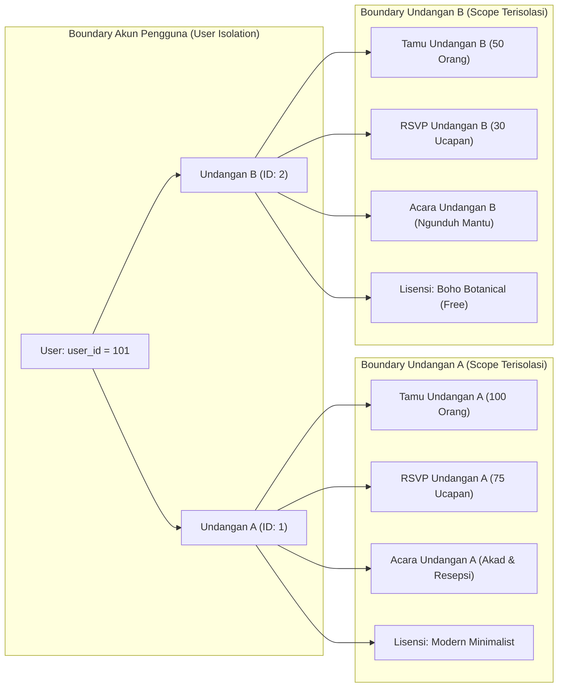

# Entity Relationship Diagram (ERD) — Undangan Online (InfoMase)

Dokumen ini memuat diagram visual relasi antarentitas (*Entity Relationship Diagram*) sistem database Undangan Online menggunakan sintaks **Mermaid ER Diagram**. Diagram ini memetakan seluruh tabel, atribut kunci, tipe relasi, kardinalitas, dan batasan integritas referensial.

---

## 1. Visual Entity Relationship Diagram (Mermaid)

```mermaid
erDiagram
    %% ==========================================
    %% SYSTEM & MASTER ENTITIES
    %% ==========================================
    TEMPLATE_CATEGORIES ||--o{ TEMPLATES : "categorizes"
    TEMPLATES ||--o{ INVITATIONS : "styles"
    TEMPLATES ||--o{ ORDERS : "purchased_in"
    TEMPLATES ||--o{ TEMPLATE_LICENCES : "licensed_for"

    %% ==========================================
    %% USER & AUTH ENTITIES
    %% ==========================================
    USERS ||--o{ USER_TOKENS : "has_sessions"
    USERS ||--o{ INVITATIONS : "owns"
    USERS ||--o{ ORDERS : "places"

    %% ==========================================
    %% INVITATION CHILD ENTITIES (1:1 Relationships)
    %% ==========================================
    INVITATIONS ||--|| INVITATION_COUPLES : "has_couple_profile"
    INVITATIONS ||--|| INVITATION_QUOTES : "has_quote"
    INVITATIONS ||--|| INVITATION_MUSICS : "has_music"
    INVITATIONS ||--o| INVITATION_GIFTS : "has_gift_address"
    INVITATIONS ||--o| INVITATION_STREAMINGS : "broadcasts"

    %% ==========================================
    %% INVITATION CHILD ENTITIES (1:N Relationships)
    %% ==========================================
    INVITATIONS ||--o{ INVITATION_EVENTS : "schedules"
    INVITATIONS ||--o{ INVITATION_STORIES : "chronicles"
    INVITATIONS ||--o{ INVITATION_GALLERIES : "showcases"
    INVITATIONS ||--o{ INVITATION_BANK_ACCOUNTS : "receives_transfers"
    INVITATIONS ||--o{ INVITATION_GUESTS : "invites"
    INVITATIONS ||--o{ INVITATION_RSVPS : "receives_rsvps"
    INVITATIONS ||--o{ INVITATION_WA_TEMPLATES : "customizes_wa_drafts"
    INVITATIONS ||--o{ INVITATION_VISITOR_LOGS : "logs_traffic"

    %% ==========================================
    %% MONETIZATION & ENTITLEMENTS
    %% ==========================================
    ORDERS ||--o| TEMPLATE_LICENCES : "unlocks"
    ORDERS ||--o{ PAYMENTS : "settled_via"
    INVITATIONS ||--o{ TEMPLATE_LICENCES : "entitled_to"
    INVITATIONS ||--o{ ORDERS : "associated_with"

    %% ==========================================
    %% GUEST & RSVP RELATIONSHIP
    %% ==========================================
    INVITATION_GUESTS ||--o| INVITATION_RSVPS : "submits"
    INVITATION_GUESTS ||--o{ INVITATION_VISITOR_LOGS : "tracked_in"

    %% ==========================================
    %% ENTITY DEFINITIONS & ATTRIBUTES
    %% ==========================================

    USERS {
        bigint_unsigned id PK
        varchar_36 public_id UK
        varchar_100 name
        varchar_150 email UK
        varchar_255 password_hash
        varchar_30 phone_number
        varchar_255 avatar_url
        enum role "USER, ADMIN"
        enum status "ACTIVE, SUSPENDED"
        datetime last_login_at
        datetime created_at
        datetime updated_at
        datetime deleted_at
    }

    USER_TOKENS {
        bigint_unsigned id PK
        bigint_unsigned user_id FK
        varchar_64 refresh_token_hash UK
        varchar_255 device_info
        varchar_45 ip_address
        datetime expires_at
        tinyint_1 is_revoked
        datetime created_at
    }

    TEMPLATE_CATEGORIES {
        int_unsigned id PK
        varchar_50 slug UK
        varchar_100 name
        smallint_unsigned sort_order
        datetime created_at
        datetime updated_at
    }

    TEMPLATES {
        int_unsigned id PK
        varchar_50 code UK
        varchar_50 folder_id
        varchar_100 name
        varchar_255 tagline
        int_unsigned category_id FK
        decimal price
        decimal compare_at_price
        json includes_json
        json palette_json
        json typography_json
        varchar_255 ornament_description
        varchar_255 preview_image
        varchar_100 demo_slug
        enum status "available, coming_soon, deprecated"
        varchar_50 badge
        smallint_unsigned sort_order
        datetime created_at
        datetime updated_at
        datetime deleted_at
    }

    INVITATIONS {
        bigint_unsigned id PK
        varchar_36 public_id UK
        bigint_unsigned user_id FK
        varchar_80 slug UK
        varchar_150 title
        int_unsigned template_id FK
        enum status "draft, published, archived, suspended"
        tinyint_1 is_published
        datetime published_at
        datetime countdown_date
        varchar_255 cover_image_url
        varchar_255 og_image_url
        json theme_config
        datetime created_at
        datetime updated_at
        datetime deleted_at
    }

    INVITATION_COUPLES {
        bigint_unsigned id PK
        bigint_unsigned invitation_id FK,UK
        varchar_50 groom_name
        varchar_100 groom_full_name
        varchar_100 groom_father_name
        varchar_100 groom_mother_name
        varchar_255 groom_photo_url
        varchar_50 groom_instagram
        text groom_bio
        varchar_50 bride_name
        varchar_100 bride_full_name
        varchar_100 bride_father_name
        varchar_100 bride_mother_name
        varchar_255 bride_photo_url
        varchar_50 bride_instagram
        text bride_bio
        datetime created_at
        datetime updated_at
    }

    INVITATION_QUOTES {
        bigint_unsigned id PK
        bigint_unsigned invitation_id FK,UK
        text quote_text
        varchar_150 quote_source
        text quote_translation
        datetime created_at
        datetime updated_at
    }

    INVITATION_EVENTS {
        bigint_unsigned id PK
        varchar_36 public_id UK
        bigint_unsigned invitation_id FK
        varchar_100 title
        date event_date
        time start_time
        time end_time
        varchar_10 timezone
        varchar_150 location_name
        text address
        varchar_500 maps_url
        varchar_500 streaming_url
        varchar_50 streaming_platform
        smallint_unsigned sort_order
        datetime created_at
        datetime updated_at
    }

    INVITATION_STORIES {
        bigint_unsigned id PK
        varchar_36 public_id UK
        bigint_unsigned invitation_id FK
        varchar_30 year_label
        varchar_150 title
        text description
        varchar_255 image_url
        smallint_unsigned sort_order
        datetime created_at
        datetime updated_at
    }

    INVITATION_GALLERIES {
        bigint_unsigned id PK
        varchar_36 public_id UK
        bigint_unsigned invitation_id FK
        varchar_255 photo_url
        varchar_255 caption
        int_unsigned width
        int_unsigned height
        int_unsigned file_size
        smallint_unsigned sort_order
        datetime created_at
        datetime updated_at
    }

    INVITATION_MUSICS {
        bigint_unsigned id PK
        bigint_unsigned invitation_id FK,UK
        varchar_150 title
        varchar_150 artist
        varchar_255 audio_url
        tinyint_1 autoplay
        datetime created_at
        datetime updated_at
    }

    INVITATION_BANK_ACCOUNTS {
        bigint_unsigned id PK
        varchar_36 public_id UK
        bigint_unsigned invitation_id FK
        varchar_50 bank_name
        varchar_50 account_number
        varchar_100 account_holder
        varchar_255 qris_image_url
        smallint_unsigned sort_order
        datetime created_at
        datetime updated_at
    }

    INVITATION_GIFTS {
        bigint_unsigned id PK
        bigint_unsigned invitation_id FK,UK
        varchar_100 recipient_name
        varchar_30 phone_number
        text full_address
        datetime created_at
        datetime updated_at
    }

    INVITATION_STREAMINGS {
        bigint_unsigned id PK
        bigint_unsigned invitation_id FK,UK
        tinyint_1 is_enabled
        varchar_50 platform
        varchar_500 stream_url
        datetime start_time
        datetime created_at
        datetime updated_at
    }

    INVITATION_GUESTS {
        bigint_unsigned id PK
        varchar_36 public_id UK
        bigint_unsigned invitation_id FK
        varchar_30 guest_code
        varchar_150 name
        varchar_50 category
        varchar_30 phone_number
        smallint_unsigned max_pax
        varchar_255 notes
        tinyint_1 is_checked_in
        datetime checked_in_at
        datetime created_at
        datetime updated_at
    }

    INVITATION_RSVPS {
        bigint_unsigned id PK
        varchar_36 public_id UK
        bigint_unsigned invitation_id FK
        bigint_unsigned guest_id FK
        varchar_150 guest_name
        enum attendance "hadir, tidak, ragu"
        smallint_unsigned pax
        text message
        varchar_45 ip_address
        varchar_255 user_agent
        datetime created_at
        datetime updated_at
    }

    INVITATION_WA_TEMPLATES {
        bigint_unsigned id PK
        varchar_36 public_id UK
        bigint_unsigned invitation_id FK
        varchar_100 name
        text body
        json assigned_categories_json
        tinyint_1 is_default
        datetime created_at
        datetime updated_at
    }

    ORDERS {
        bigint_unsigned id PK
        varchar_36 public_id UK
        varchar_50 order_number UK
        bigint_unsigned user_id FK
        bigint_unsigned invitation_id FK
        int_unsigned template_id FK
        decimal amount
        varchar_3 currency
        enum status "pending, confirmed, failed, cancelled, refunded"
        enum payment_method "qris, bank-transfer, ewallet"
        datetime paid_at
        datetime created_at
        datetime updated_at
    }

    PAYMENTS {
        bigint_unsigned id PK
        varchar_36 public_id UK
        bigint_unsigned order_id FK
        varchar_50 payment_number UK
        enum payment_method "qris, bank-transfer, ewallet"
        decimal amount
        varchar_3 currency
        varchar_50 gateway_name
        varchar_100 gateway_transaction_id
        json gateway_payload_json
        varchar_255 proof_of_transfer_url
        enum status "pending, verified, rejected, expired"
        datetime verified_at
        datetime created_at
        datetime updated_at
    }

    TEMPLATE_LICENCES {
        bigint_unsigned id PK
        varchar_36 public_id UK
        bigint_unsigned invitation_id FK
        int_unsigned template_id FK
        bigint_unsigned order_id FK,UK
        enum kind "perpetual"
        enum status "active, revoked, expired"
        datetime issued_at
    }

    INVITATION_VISITOR_LOGS {
        bigint_unsigned id PK
        bigint_unsigned invitation_id FK
        bigint_unsigned guest_id FK
        varchar_45 ip_address
        varchar_255 user_agent
        enum device_type "mobile, desktop, tablet"
        datetime visited_at
    }
```

---

## 2. Cardinality & Relationship Breakdown

| Relasi Parent &rarr; Child | Kardinalitas | Aturan Referential Integrity | Deskripsi Bisnis |
|---|---|---|---|
| `users` &rarr; `invitations` | 1 : N (One-to-Many) | `ON DELETE CASCADE` | Satu pengguna dapat memiliki banyak undangan pernikahan. Menghapus akun akan menghapus seluruh undangan miliknya. |
| `users` &rarr; `orders` | 1 : N (One-to-Many) | `ON DELETE RESTRICT` | Satu pengguna dapat memiliki banyak pesanan. Pesanan dilarang dihapus jika akun user ditutup demi audit finansial. |
| `users` &rarr; `user_tokens` | 1 : N (One-to-Many) | `ON DELETE CASCADE` | Satu pengguna memiliki banyak sesi login/perangkat. Sesi otomatis hangus jika akun dihapus. |
| `invitations` &rarr; `invitation_couples` | 1 : 1 (One-to-One) | `ON DELETE CASCADE` | Setiap undangan memiliki tepat 1 profil kedua mempelai. |
| `invitations` &rarr; `invitation_quotes` | 1 : 1 (One-to-One) | `ON DELETE CASCADE` | Setiap undangan memiliki tepat 1 blok kutipan ayat suci/kata mutiara. |
| `invitations` &rarr; `invitation_musics` | 1 : 1 (One-to-One) | `ON DELETE CASCADE` | Setiap undangan memiliki tepat 1 pengaturan lagu latar. |
| `invitations` &rarr; `invitation_gifts` | 1 : 1 (One-to-One, Opsional) | `ON DELETE CASCADE` | Setiap undangan memiliki maksimal 1 alamat pengiriman kado fisik. |
| `invitations` &rarr; `invitation_streamings` | 1 : 1 (One-to-One, Opsional) | `ON DELETE CASCADE` | Setiap undangan memiliki maksimal 1 konfigurasi siaran langsung pernikahan virtual (YouTube/IG/Zoom). |
| `invitations` &rarr; `invitation_events` | 1 : N (One-to-Many) | `ON DELETE CASCADE` | Setiap undangan dapat memiliki banyak rangkaian acara (Akad, Resepsi, dll). |
| `invitations` &rarr; `invitation_stories` | 1 : N (One-to-Many) | `ON DELETE CASCADE` | Setiap undangan dapat memiliki banyak linimasa cerita perjalanan cinta. |
| `invitations` &rarr; `invitation_galleries` | 1 : N (One-to-Many) | `ON DELETE CASCADE` | Setiap undangan dapat memiliki banyak foto galeri prewedding. |
| `invitations` &rarr; `invitation_bank_accounts` | 1 : N (One-to-Many) | `ON DELETE CASCADE` | Setiap undangan dapat memiliki banyak nomor rekening bank/dompet digital. |
| `invitations` &rarr; `invitation_guests` | 1 : N (One-to-Many) | `ON DELETE CASCADE` | Setiap undangan memiliki daftar tamu independen yang tidak saling tercampur antar-undangan. |
| `invitations` &rarr; `invitation_rsvps` | 1 : N (One-to-Many) | `ON DELETE CASCADE` | Setiap undangan menampung ucapan dan konfirmasi kehadiran dari para tamunya. |
| `invitations` &rarr; `invitation_wa_templates` | 1 : N (One-to-Many) | `ON DELETE CASCADE` | Setiap undangan memiliki template kalimat WhatsApp yang dapat dikustomisasi per kategori. |
| `templates` &rarr; `invitations` | 1 : N (One-to-Many) | `ON DELETE RESTRICT` | Satu desain template dipakai oleh banyak undangan. Template dilarang dihapus jika masih digunakan oleh undangan aktif. |
| `orders` &rarr; `template_licences` | 1 : 1 (One-to-One) | `ON DELETE RESTRICT` | Satu transaksi pesanan template yang berstatus terkonfirmasi menerbitkan tepat satu lisensi permanen. |
| `orders` &rarr; `payments` | 1 : N (One-to-Many) | `ON DELETE CASCADE` | Satu pesanan dapat memiliki beberapa percobaan pembayaran (misal ganti dari transfer ke QRIS). |
| `invitations` &rarr; `template_licences` | 1 : N (One-to-Many) | `ON DELETE CASCADE` | Satu undangan dapat memiliki beberapa lisensi jika pengguna membeli lebih dari satu varian desain untuk acara tersebut. |
| `invitation_guests` &rarr; `invitation_rsvps` | 1 : 1 (One-to-One, Opsional) | `ON DELETE SET NULL` | Tamu yang membuka link personal terhubung ke RSVP miliknya. Jika record tamu dihapus, pesan ucapan tetap tersimpan dengan `guest_id = NULL`. |
| `invitation_guests` &rarr; `invitation_visitor_logs` | 1 : N (One-to-Many, Opsional) | `ON DELETE SET NULL` | Tamu yang mengunjungi undangan tercatat pada visitor log. Jika data tamu dihapus, log analitik tetap utuh. |

---

## 3. Data Isolation & Tenant Security Boundary

### Jaminan Keamanan Isolasi Data:
1. **Pemisahan Antar-Akun**: Pengguna `user_id = 101` **tidak dapat melihat atau memodifikasi** undangan milik `user_id = 102`. Setiap query ke child table memverifikasi foreign key `invitation_id` yang divalidasi kepemilikannya terhadap `user_id`.
2. **Pemisahan Antar-Undangan**: Tamu pada Undangan A **tidak akan pernah muncul** di daftar tamu Undangan B, begitu pula sebaliknya.
3. **Pencegahan Kebocoran Lisensi**: Lisensi `template_licences` terikat unik pada kombinasi `(invitation_id, template_id)`. Pembelian lisensi untuk Undangan A **tidak dapat dipakai** untuk menayangkan Undangan B. Undangan B harus membeli lisensi sendiri jika menggunakan template berbayar.

